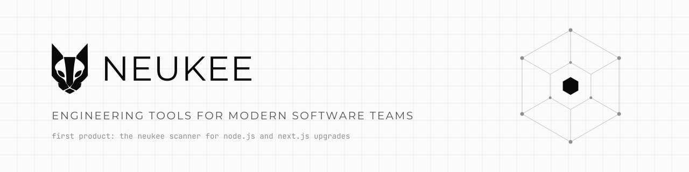

  <picture>
    <source media="(prefers-color-scheme: dark)" srcset="assets/org-banner-dark.svg">
    
  </picture>

  
  
  
  
  

<h3 align="center">Upgrades shouldn't be a leap of faith.</h3>

We build engineering tools for modern software teams. The first one reads your repository the way 
a careful reviewer would, and tells you what breaks <b>before</b> you upgrade Node.js or Next.js.

---

### 🐾 [neukee/neukee](https://github.com/neukee/neukee): the upgrade scanner

Point it at a repository and a target version. It is being built to check your code and configuration against the **official release notes** for that version, and to point at the exact lines that will break.

| Built to find | For example |
| --- | --- |
| **Runtime drift** | `.nvmrc` says 24 but the Dockerfile still runs 20; a Node.js version past end-of-life |
| **Native addons** | dependencies that compile native code at install time and break on a new Node.js version |
| **Next.js 16 changes** | request APIs that became async, and config options that changed |
| **What you really install** | versions from npm and pnpm lockfiles, not just `package.json` ranges |

Results will go to your terminal, Markdown, JSON or SARIF, so they can show up in GitHub code scanning.

### Why teams can trust it

<table>
<tr>
<td width="50%" valign="top">

**🔒 Your code never leaves your machine.** 
No network calls, no telemetry, and it never runs your code, scripts or package manager. The tests block the network on purpose.

</td>
<td width="50%" valign="top">

**📚 Every rule has a source.** 
Each finding links the official release note it comes from. No rule is written from memory or a blog post.

</td>
</tr>
<tr>
<td width="50%" valign="top">

**🎯 Same input, same output.** 
Reports are deterministic and sorted by a total order, so they are safe to snapshot and diff in CI.

</td>
<td width="50%" valign="top">

**🛡️ Built for hostile input.** 
Every scanned file is untrusted: size caps, no symlinks followed, bounded matching work, and a `.gitignore` matcher tested against real git.

</td>
</tr>
</table>

### Where it stands

**Pre-release.** Version 0.1.0 is planned for **December 8, 2026**, and the work happens in the open: every task, decision and review lives in the repository.

  <a href="https://github.com/neukee/neukee"><b>⭐ Star the repository</b></a> to follow the launch ·
  <a href="https://github.com/neukee/neukee/blob/main/docs/TASKS.md">See the plan</a> ·
  <a href="https://github.com/neukee/neukee/issues/new/choose">Tell us what blocks your upgrade</a>

### Follow

[LinkedIn](https://www.linkedin.com/company/neukee) · [X](https://x.com/neukee4dev) · [Crunchbase](https://www.crunchbase.com/organization/neukee)

Neukee · engineering tools for modern software teams

